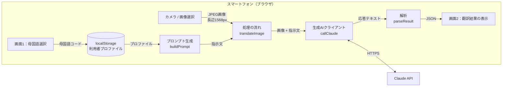

# 駅案内 翻訳プロトタイプ（最小構成）

利用者プロファイル（今回は「母国語」の1項目のみ）を生成AIに渡し、駅構内の案内表示を翻訳して表示する試作品。
2026/11/16 打合せの決定事項「利用者情報を1つに絞り、入力 → 生成AI → 表示を一気通貫で実装する」に対応する。

## 使い方

1. `index.html` をHTTPS（暗号化通信）で配信する
   - 例：GitHub Pages、Netlify Drop（ファイルをドラッグするだけで公開できるサービス）
   - スマホのブラウザがカメラを直接起動できるのはHTTPSのページだけ。HTTPで開いた場合も、「画像を選ぶ」からの撮影は使える
2. スマートフォンのブラウザでページを開く
3. 母国語を選ぶ
4. 右上の ⚙︎ を押し、Claude APIキーを入力する（APIキーなしで画面の流れだけを試す場合は「デモモード」をオンにする）
5. 「📷 撮影して翻訳」を押すと、案内表示の翻訳が表示される

画面下の「処理ログ」で、どのデータがどの順に渡ったかを確認できる。

## システム構成図



## 処理フロー（データの流れ）

| 順番 | 処理 | 受け取るデータ | 次に渡すデータ |
|---|---|---|---|
| ① | 利用者プロファイル読込 | localStorage | `{ nativeLanguage: "en" }` |
| ② | 画像取得（撮影 or 選択） | カメラ映像 / 画像ファイル | 縮小したJPEG（base64形式の文字列） |
| ③ | プロンプト生成 `buildPrompt` | プロファイル | 生成AIへの指示文（翻訳先の言語、出力形式） |
| ④ | 生成AI呼び出し `callClaude` | 画像 + 指示文 | 応答テキスト |
| ⑤ | 解析 `parseResult` | 応答テキスト | `{ summary, signs[], note }` |
| ⑥ | 表示 `renderResult` | 解析結果 | 画面 |

生成AIからの出力形式：

```json
{
  "summary": "この表示が伝えていることの要約（母国語）",
  "signs": [
    { "original": "南口", "translated": "South Exit", "category": "exit" }
  ],
  "note": "読み取れなかった部分などの注意"
}
```

## モジュール（機能のまとまり）一覧

`index.html` の `<script>` 内に、番号付きコメントで区切って記述している。

| No. | モジュール | 役割 |
|---|---|---|
| 1 | 定数 | 対応言語の一覧、案内表示カテゴリのアイコン、画像サイズ |
| 2 | 保存 `Store` / `state` | 利用者プロファイルと設定をブラウザ内に保持する |
| 3 | 処理ログ `Log` | 各処理の実行内容を画面に記録する |
| 4 | カメラ `Camera` | カメラの起動・停止、撮影、画像の縮小 |
| 5 | プロンプト生成 `buildPrompt` | プロファイルを生成AIへの指示文に変換する（**属性を増やすときに主に拡張する箇所**） |
| 6 | 生成AIクライアント `callClaude` | Claude APIの呼び出し、応答の解析 |
| 7 | 表示 `renderResult` | 翻訳結果を画面に描画する |
| 8 | 処理の流れ `translateImage` | ①〜⑥を順番に実行する |

## 他の属性へ拡張するとき

1. `state.profile` に項目を追加する（例：`age`、`walkingSpeed`）
2. 画面1に入力欄を追加する
3. `buildPrompt` の指示文に、その属性に応じた指示を追記する（例：高齢者なら階段を避ける経路を優先する）

## 注意（試作用の構成）

- APIキーをブラウザ内に保存し、ブラウザから直接APIを呼んでいる。社外の人に配布・公開する場合は、サーバーを経由する方式に切り替えること
- 撮影した画像は生成AIのAPIに送信される。人の顔などが写り込む場合の扱いは、実験計画で整理が必要
- 初期設定のモデルは `claude-sonnet-5-5`。速度を優先する場合は、設定画面で `claude-haiku-5-5` を選ぶ
