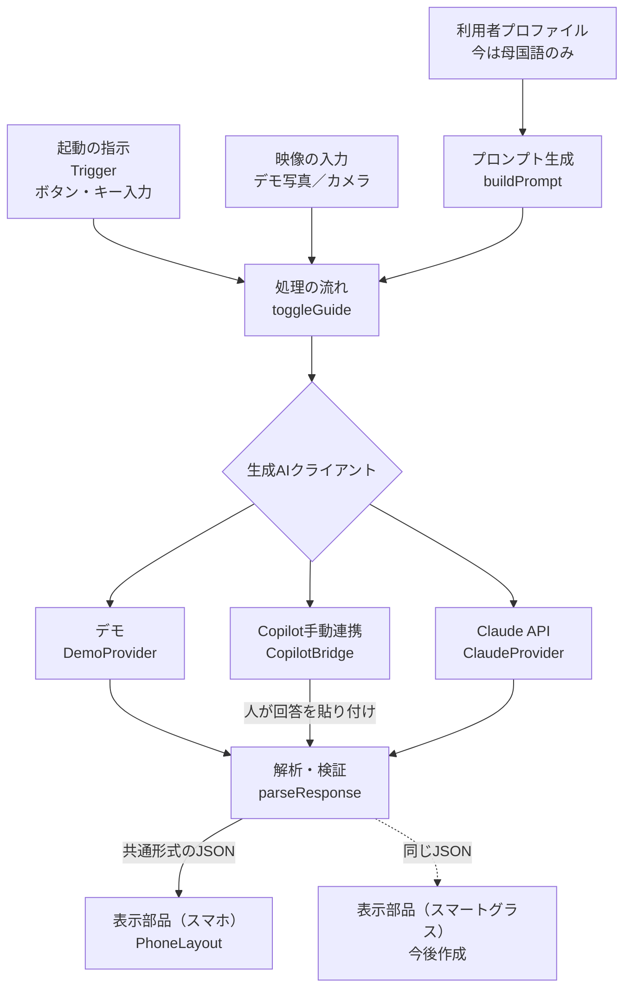

# 駅案内ARプロトタイプ（利用者プロファイル × 生成AI）

利用者プロファイル（今回は「母国語」の1項目のみ）を生成AIに渡し、カメラに映った駅の案内サインを母国語で案内する試作品です。
案内サインを光る枠で囲み、そこから線を伸ばしたガラス調のパネルに、母国語の案内を表示します。

- 対象：スマートフォンの**横画面**（最終的にはスマートグラスでの実装を想定）
- 形式：HTMLファイル1つ（`index.html`）。デモ用の駅の写真も埋め込み済み
- 公開：GitHub Pagesなど、HTTPS（暗号化通信）で配信できる場所に`index.html`を置く

## 使い方

1. スマホのブラウザでページを開き、**横向き**にする（縦向きでは「横向きにしてください」と表示される）
2. 母国語を選ぶ（英語・中国語〔簡体字／繁体字〕・韓国語・ベトナム語・スペイン語）
3. 中央の **GUIDE** ボタンを押すと案内が始まる。もう一度押す（CLOSE）と通常の画面に戻る

右端のボタン：LANG（言語の変更）／GUIDE（案内の開始・終了）／SET（設定）。
Androidでは、右上のボタンで全画面表示にできる。

## 3つの方式（SETで切り替え）

| 方式 | 内容 | APIキー | 料金 |
|---|---|---|---|
| **デモシーン**（初期設定） | 内蔵の駅の写真で、案内の見え方を確認する | 不要 | 無料 |
| **カメラ＋Copilot（手動連携）** | 撮影した写真をCopilotアプリに渡し、回答を貼り付けて表示する | 不要 | 無料（Copilotの利用範囲内） |
| **カメラ＋生成AI** | 撮影から表示までを自動で行う（Claude APIを使用） | 必要 | 1回約1円強 |

- APIキー欄とモデル欄は、「カメラ＋生成AI」を選んだときだけ表示される
- Enterキー・スペースキーでもGUIDEを押せる（Bluetoothのシャッターリモコンで、スマートグラスのボタン操作の代わりに試せる）

### デモシーン

- 背景は実際の駅構内の写真。**写っている人物45人はすべてぼかし処理済み**
- 写真内の案内サイン10か所の位置をあらかじめ測って設定しているため、枠と線が実際のサインにぴったり合う
- 案内文は、生成AIが返す想定の応答（後述の共通形式のJSON）を6言語分あらかじめ用意したもの。毎回同じ結果になる

### カメラ＋Copilot（手動連携）の手順

APIを使わずに生成AIを利用するため、写真と回答の受け渡しを人が手作業で行う方式です。

1. 看板にカメラを向けて **GUIDE** を押す（カメラが使えない端末では写真を選ぶ）
2. 左に手順の画面が出るので「**Copilotに送る**」を押し、共有先でCopilotを選ぶ
   - 写真と指示文（母国語・回答形式を指定したもの）が渡る
   - 指示文はクリップボードにもコピー済み。共有先で指示文が入らない場合は貼り付ける
   - 共有できない場合は「画像を保存」「指示文をコピー」で手動で渡す
3. Copilotの回答（JSON）をコピーする
4. アプリに戻って「**貼り付け**」→「**表示する**」を押すと、撮影した写真の上に線とパネルが出る

CopilotがJSON以外の形で答えた場合は、エラーが表示される。Copilotに「JSONだけで答えてください」と再度依頼する。

## システム構成図



設計の考え方：

- 生成AIは「何を伝えるか」だけを、**端末に依存しない共通形式（JSON）**で返す
- 「どこにどう表示するか」は、端末ごとの表示部品が決める
- 生成AIの種類（デモ／Copilot／Claude API）を替えても、解析から表示までは共通

## 処理の流れ（データの流れ）

| 順番 | 処理 | 内容 |
|---|---|---|
| ① | 起動の指示 | GUIDEボタンまたはキー入力 |
| ② | 利用者プロファイル | 母国語（例：`en`）を読み込む |
| ③ | 画像の取得 | デモ写真、またはカメラの映像を撮影（長辺1568pxに縮小） |
| ④ | プロンプト生成 | 母国語と回答形式を指定した指示文を作る |
| ⑤ | 生成AIへ送信 | デモ／Copilotへ共有（手動）／Claude API |
| ⑥ | 応答の受信 | Copilotの場合は、人が回答を貼り付ける |
| ⑦ | 解析・検証 | 回答を共通形式に整え、値の範囲を確認する |
| ⑧ | 表示 | 枠・線・パネル・要約バーを描く |

各処理の実行内容と生成AIの回答（JSON）は、SET画面の「処理ログ」で確認できる。

## 生成AIの応答形式（共通の約束）

```json
{
  "summary": "この場所が利用者に伝えていることの要約（母国語）",
  "signs": [
    {
      "id": 4,
      "bbox": [0.4313, 0.4161, 0.0388, 0.06],
      "original": "↑ 新幹線 Shinkansen",
      "category": "line",
      "label": "↑ Shinkansen",
      "guidance": "Shinkansen transfer gates are straight ahead.",
      "priority": 1
    }
  ],
  "note": "読み取れなかった部分などの注意（母国語）"
}
```

| 項目 | 内容 | 使い道 |
|---|---|---|
| `bbox` | サインの位置 `[x, y, 幅, 高さ]`。画像の左上を0、右下を1とした割合 | 枠と線の根元の位置。画面サイズに依存しない |
| `original` | サインに書かれた元の表記 | 確認用 |
| `category` | exit / line / platform / direction / facility / ticket / notice / other | パネルのアイコン |
| `label` | 母国語の短いラベル（4語程度まで） | パネルの見出し。スマートグラスの狭い視界でも読める長さ |
| `guidance` | プロファイルに合わせた一言の案内 | パネルの説明文 |
| `priority` | 1（重要）〜3 | パネルに出すサインの選択 |

## 表示の配置ルール（スマホ用の表示部品）

1. `priority`の高い順に**最大4件**をパネルにする。残りは下の要約バーに一覧で出す
2. パネルは上段と下段に分ける
   - サインが上下に散らばっている場合：上半分のサインは上段、下半分は下段
   - サインが横一列に並ぶ場合（吊り下げサインなど）：左から交互に上段・下段
3. 各パネルはサインの真上（真下）を基本に置き、パネル同士が重なる場合は左右にずらす
4. パネルがサインにかかる場合は、案内文を1行に詰める
5. 画面の高さが小さい場合（760px未満、横画面では常に該当）は、パネルを詰めて表示する

## モジュール（機能のまとまり）一覧

`index.html`の`<script>`内に、番号付きのコメントで区切って記述しています。

| No. | モジュール | 役割 | スマートグラス化での扱い |
|---|---|---|---|
| 1 | 定数・アイコン | 対応言語、カテゴリのアイコン、パネル数などの設定 | そのまま |
| 2 | 保存 `Store` / `state` | 利用者プロファイル・設定をブラウザ内に保持 | そのまま |
| 3 | 処理ログ `Log` | 処理の記録と生成AIの回答の表示 | そのまま（評価実験のデータ取得に使える） |
| 4 | 起動の指示 `Trigger` | ボタン・キー入力で開始／終了 | **差し替え**（音声・つるのボタンなど） |
| 5 | 映像の入力 `Camera` | カメラの起動・撮影・縮小 | **差し替え**（グラスのカメラ） |
| 6 | プロンプト生成 `buildPrompt` | プロファイル → 生成AIへの指示文 | そのまま（属性を増やすときに拡張） |
| 7 | 生成AIクライアント `ClaudeProvider` / `DemoProvider` | 生成AIの呼び出し、デモ用の想定応答 | そのまま（別のAIに替える場合はここだけ） |
| 8 | 解析・検証 `parseResponse` | 回答を共通形式に整える | そのまま |
| 9 | 表示部品 `PhoneLayout` | 枠・線・パネル・要約バーを描く | **差し替え**（視界に合わせた表示） |
| 10 | 処理の流れ `toggleGuide` / `endGuide` | ①〜⑧を順に実行 | そのまま |
| 11 | Copilot手動連携 `CopilotBridge` | 写真と指示文の共有、回答の貼り付け | API利用に切り替える際は不要 |

## 今後の検討事項

- **位置の精度：** 実際の駅で撮影した写真について、生成AI（Copilot）が返すサインの位置がどれだけ正確かを確かめる
- **スマートグラスでの表示：** 現実の風景に重ねて表示するため、サインの位置にリアルタイムで追従させる必要がある（静止画で表示するのは、スマホでの検証用）
- **利用者の意図：** 「〇〇線に行きたい」などの行き先をプロファイルに加え、案内の内容を変える
- **言語の追加：** デモの案内文は6言語分のみ。Copilot・Claude APIの方式では、指示文で指定すれば他の言語にも対応できる

## 注意事項

- **公開範囲：** GitHub Pagesの公開ページは誰でも見られる。デモ写真（人物はぼかし済み。店舗名・商業施設名は写っている）を公開してよいか、事前に社内で確認する
- **APIキー：** 「カメラ＋生成AI」では、APIキーをブラウザ内（localStorage）に保存し、ブラウザから直接APIを呼んでいる。社外の人に使ってもらう場合は、サーバーを経由する方式に切り替える
- **撮影画像の扱い：** Copilot・Claude APIの方式では、撮影した画像が各社のクラウドに送られる。人の顔などが写り込む場合の扱いは、実験計画で整理する

## ファイル

| ファイル | 内容 |
|---|---|
| `index.html` | アプリ本体（デモ写真を含む） |
| `README.md` | この説明書 |
| `demo-scene-blurred.jpg` | デモ写真単体（人物ぼかし済み）。アプリの動作には不要 |
